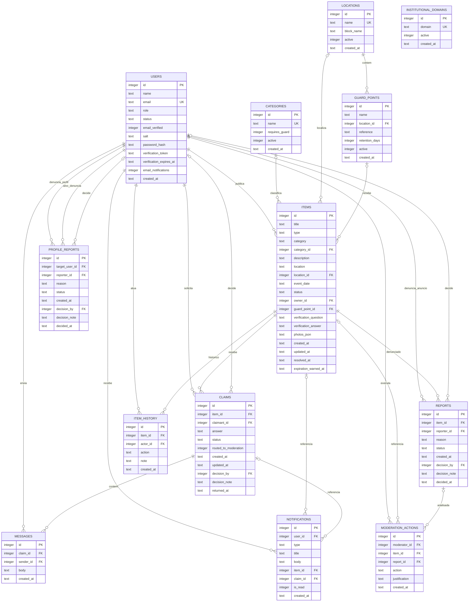

# Diagrama Entidade-Relacionamento (DER) — implementação Python + SQLite

Este DER representa o banco criado por `init_db()` em `app.py`, não o esquema previsto na arquitetura original Laravel/MySQL. O arquivo em execução é `data/encontrei.sqlite3`.

## Tabelas e responsabilidades

| Tabela | Finalidade |
|---|---|
| `users` | Contas, papel, status, hash da senha e estado/token de verificação. |
| `institutional_domains` | Lista administrável de domínios de e-mail aceitos no cadastro. |
| `categories` | Catálogo de categorias, com sinalizador para obrigatoriedade de ponto de guarda e estado ativo. |
| `locations` | Catálogo de locais do campus e seu bloco/prédio. |
| `guard_points` | Pontos físicos autorizados, locais e prazo de retenção. |
| `items` | Anúncios de achados/perdidos, classificação, publicador, estado, fotos e pergunta/resposta privada. `category` e `location` também são mantidos como snapshot textual para preservar a leitura histórica caso o catálogo mude. |
| `claims` | Reivindicações, estado, encaminhamento à moderação, decisão e data da devolução. |
| `reports` | Denúncias de anúncios com status e decisão de moderação. |
| `profile_reports` | Denúncias de perfil com integridade que impede autodenúncia e repetição da mesma denúncia pela mesma conta. |
| `messages` | Conversas associadas à reivindicação aprovada. |
| `notifications` | Notificações in-app do usuário, com referência opcional ao item e à reivindicação. |
| `moderation_actions` | Auditoria de ações de moderação com autor, ação, data e justificativa. |
| `item_history` | Histórico de alterações, resolução, devolução e expiração de um anúncio. |

## Integridade, restrições e índices

- Todas as tabelas têm chave primária `INTEGER PRIMARY KEY AUTOINCREMENT`.
- As referências relacionais usam `REFERENCES`; `PRAGMA foreign_keys=ON` é habilitado em cada conexão.
- `users.email`, `institutional_domains.domain`, `categories.name` e `locations.name` são únicos, com comparação sem distinção entre maiúsculas/minúsculas quando configurada no esquema.
- `users.role` aceita `Estudante`, `Moderador` ou `Administrador`; `status` é validado na lógica entre `Ativo`, `Suspenso` e o estado de cadastro `Pendente`.
- `items.type` limita-se a `Achado` ou `Perdido`; o restante das transições de status é validado no backend.
- `guard_points.retention_days` deve estar entre 30 e 365; `messages.body` deve ter de 1 a 500 caracteres; booleanos guardados em SQLite usam `CHECK` de 0/1.
- `reports` possui unicidade `(item_id, reporter_id)`, e `profile_reports` possui unicidade `(target_user_id, reporter_id)` e `CHECK(target_user_id <> reporter_id)`.
- Índice único parcial `one_active_claim_per_user_item` impede duas reivindicações pendentes/aprovadas do mesmo usuário para o mesmo item. O índice único parcial `one_approved_claim_per_item` garante RN09 também no banco: apenas uma reivindicação pode permanecer aprovada por item.
- Índices auxiliares cobrem status/tipo/data de anúncios, publicador/status, status/data de reivindicação e denúncia, notificações por usuário/leitura/data, mensagens por reivindicação/data, histórico por item/data e denúncias de perfil por alvo/status.
- `photos_json` guarda caminhos relativos às fotos em JSON; os binários ficam em `uploads/`.
- A resposta de verificação fica no banco local e não é devolvida nos detalhes públicos. É informação de demonstração; não usar itens/dados reais neste pacote acadêmico.

## Dados iniciais

Na primeira execução, `init_db()` cria os catálogos de categorias e locais, domínios de teste `campus.edu.br` e `alunos.campus.edu.br`, o ponto de guarda da portaria, quatro usuários de demonstração e cinco anúncios fictícios com imagens geradas localmente. A operação é idempotente: usuários/catálogos existentes não são inseridos novamente.

## Observação de coerência

O DER aqui apresentado corresponde ao schema da versão local atual. Ele substitui, para esta implementação, o modelo original feito para a arquitetura Laravel/MySQL. O `README.md` e a matriz `docs/implementacao/escopo-mvp.md` identificam as adaptações e os requisitos parcialmente atendidos.
