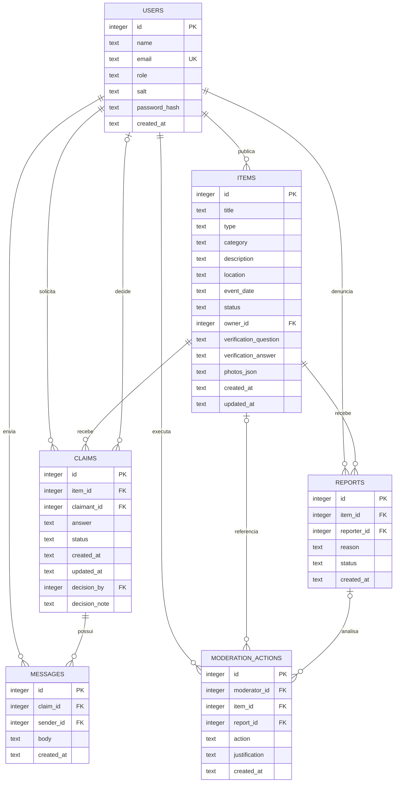

# Diagrama Entidade-Relacionamento (DER) — versão local simplificada

Este DER corresponde ao esquema SQLite criado pela função `init_db()` em `app.py`. Ele representa o banco que é realmente utilizado pela versão simplificada, e não o esquema planejado originalmente para Laravel/MySQL.

## Tabelas e relacionamentos

- **`users`** armazena contas de demonstração. `email` é único, sem diferenciar maiúsculas de minúsculas. A senha não é guardada em texto puro: o sistema armazena um salt e o hash PBKDF2.
- **`items`** armazena anúncios de achados e perdidos. `owner_id` referencia quem publicou o anúncio. `photos_json` guarda uma lista de caminhos de imagem em formato JSON textual, e as imagens ficam no diretório `uploads/`.
- **`claims`** registra reivindicações de um item por um usuário. `decision_by` é opcional e referencia o usuário que tomou a decisão.
- **`reports`** registra denúncias. A combinação `(item_id, reporter_id)` é única, impedindo a mesma conta de denunciar repetidamente o mesmo item.
- **`moderation_actions`** registra decisões de moderação com justificativa. As referências a item e denúncia podem ser nulas quando a ação não está ligada a uma denúncia específica.
- **`messages`** guarda mensagens da conversa associada a uma reivindicação aprovada.

## Integridade e regras relevantes

- O SQLite é acessado por `sqlite3`, e `PRAGMA foreign_keys = ON` é ativado em cada conexão.
- `items.type` aceita `Achado` ou `Perdido`; o estado inicial do anúncio é `Aberto`.
- O índice único parcial `one_active_claim_per_user_item` impede mais de uma reivindicação `Pendente` ou `Aprovada` da mesma conta para o mesmo item.
- As tabelas utilizam chaves primárias autoincrementais. As relações entre anúncios, reivindicações, denúncias, mensagens e ações de moderação são protegidas por chaves estrangeiras.
- As validações adicionais (como foto obrigatória para item achado, pergunta/resposta de verificação, limites de publicação, permissões e estados) são aplicadas pela lógica da aplicação em `app.py`.

## Limitações desta modelagem local

Este é um esquema pequeno, voltado para execução em uma máquina e apresentação acadêmica. Categorias e locais são textos em `items`, em vez de entidades normalizadas; fotos são guardadas em uma lista JSON; não existem as tabelas separadas de notificações, correspondências, domínios institucionais e pontos de guarda planejadas para a arquitetura original. A resposta de verificação permanece armazenada em `items.verification_answer` no banco local, embora não seja exposta pela consulta pública de detalhes. Não use esta configuração para dados sensíveis ou produção.
