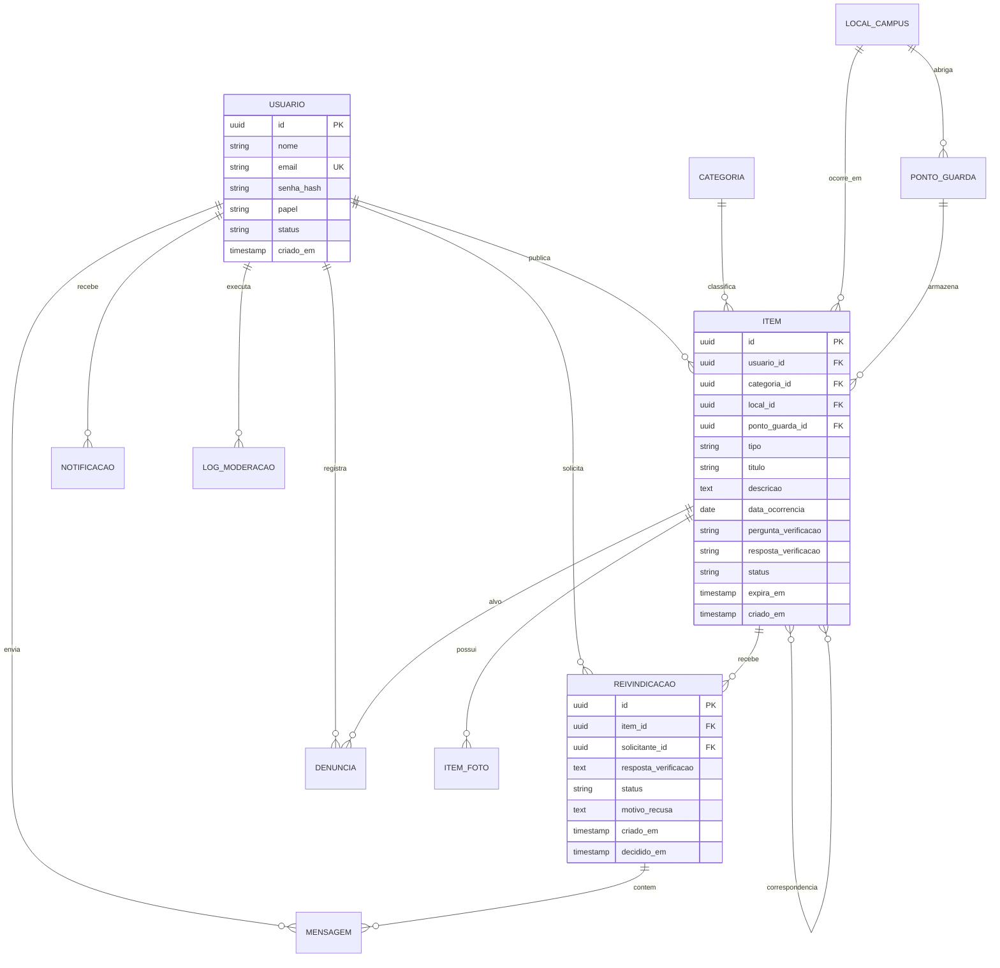

### Diagrama Entidade-Relacionamento

### Relacionamentos e restrições

- Usuário 1:N Item; Usuário 1:N Reivindicação; Usuário 1:N Notificação.
- Categoria 1:N Item; Local 1:N Item; Ponto de guarda 1:N Item.
- Item 1:N Item\_foto (máximo de 3, garantido por restrição ordem BETWEEN 1 AND 3 e unicidade de item\_id + ordem).
- Item 1:N Reivindicação; Reivindicação 1:N Mensagem.
- Item N:N Item via Correspondência (perdido × achado).
- Índice único parcial em reivindicacao (item\_id, solicitante\_id) onde status in (PENDENTE, APROVADA), garantindo a RN08.
- Índice único parcial em reivindicacao (item\_id) onde status = APROVADA, garantindo a RN09.
- Índice único em denuncia (item\_id, denunciante\_id), garantindo a regra de denúncia única (CA09.2).
- Restrição CHECK: itens do tipo ACHADO exigem pergunta\_verificacao não nula (RN05).
- Índices recomendados: item (status, tipo, categoria\_id, local\_id, criado\_em DESC) e GIN em item.busca (RNF01).
